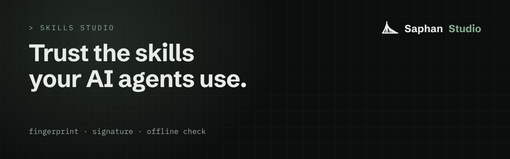
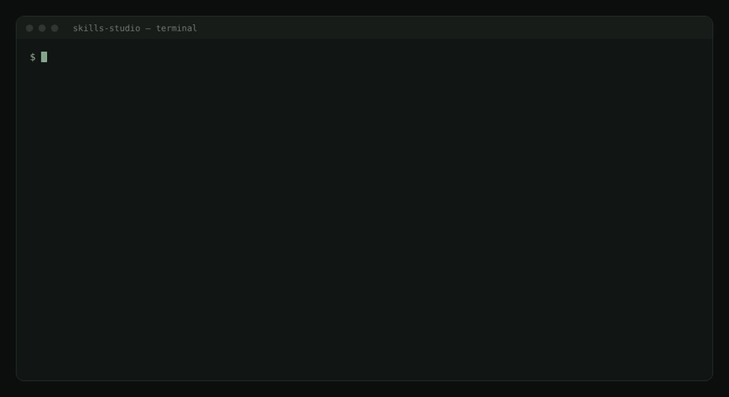

# Skills Studio: trust the skills your AI agents use

<p align="center"></p>


**For anyone who gives AI agents skills, and has to answer "can we trust this one?"** You do not need to know anything
about Saphan to read this page.

A skill is a short instruction file an agent loads when a task matches it. Skills Studio checks a skill before it
reaches your agents, records what was checked, and hands it over in a form anyone can verify again.

## Try it first (5 minutes)

You need [Go](https://go.dev/) 1.26 or newer.

Two words first. A skill's **fingerprint** is a hash of its exact text, so any change, even one byte, gives a different
fingerprint. A skill is **verified** when someone's signature over that fingerprint checks against their public key.

```
git clone https://github.com/saphan-ai/skills-studio
cd skills-studio
go install ./cmd/skills
```

<p align="center"></p>

**1. Check a real skill.** `read-files` is a small skill that comes with the examples:

```
skills verify examples/valid/read-files
```

You see its name, its fingerprint (`7273c811…`, the same as in `examples/HASHES.txt`), `format: skill-format-v1 ok`
and `signature: not checked`.

**2. Check its signature.** The examples include a signature made with a demonstration key:

```
skills verify examples/valid/read-files \
  --signature examples/signing/read-files.sig.b64 \
  --pubkey examples/signing/demo-public-key.b64
```

Now the signature line says it checks. The demonstration key's seed is public in the tests, so this signature proves
how the check works and nothing about who signed. Never sign a real skill with it.

**3. See a refusal.** This skill ships a script, which the format does not allow:

```
skills verify examples/invalid/sf-file-script/has-script
```

It exits with code `1` and names the rule it broke. Every directory under `examples/invalid/` breaks exactly one rule.

## The problem

A skill looks like documentation. It is not. **A skill is a prompt that runs with your agents' permissions.** When an
agent loads it, the text steers what the agent reads, writes, runs and sends.

Three things make that hard to trust:

- **Skills come from outside.** A developer finds a useful skill online and drops it into the team's agents. On one
  laptop that is a personal choice. In a company where agents do real work, it means unknown text runs inside a
  production process, and nobody reviewed it.
- **The same text behaves differently on different models.** A skill tuned on one model can be ignored, misread or
  over-applied by another. "It worked when I tried it" says nothing about the model your fleet uses next month.
- **Nobody can say afterwards which skill was used.** When an agent does something unexpected, the first question is
  which instructions it was given. Usually there is no record of which skills an agent carried, which version, or
  whether anyone ever approved them.

This is not a theory. In February 2026 an audit of ClawHub, a public marketplace for agent skills, found 341
malicious skills among 2,857, almost one in eight
([Cloud Security Alliance research note](https://labs.cloudsecurityalliance.org/research/csa-research-note-ai-skill-supply-chain-attacks-20260624-csa/)).

Testing a skill against your real systems to find out is the one thing you must not do. A skill that deletes, sends
or pays does it for real.

## What works today

- **One fingerprint per skill.** Every skill gets a canonical hash of its exact text. Approve a version, and any change,
  even one byte, is a different skill that needs its own approval.
- **An open format with an offline checker.** Anyone can write a skill to the format, check it with `skills verify`, and
  build their own tools on the specification.
- **Signatures you can check without a network.** A signature covers the fingerprint, so a signed skill cannot change
  without the signature failing.

## What it will be

The full path, inside [Saphan Studio](https://saphan.ai/), for a skill that comes from outside:

1. **Nothing from outside goes straight in.** A skill from the internet or from another team waits in quarantine until
   it has been checked.
2. **Checked where it cannot hurt anything.** The skill runs in a sandbox against mock systems, with the network closed.
   You see what it makes an agent do before any real system is involved.
3. **Reviewed by more than one model family.** Different models read the same text differently, so independent
   reviewers from different model families judge it. Every finding has to point at evidence: a quote from the skill or
   a recorded run.
4. **Released by a person, signed, on the record.** A skill becomes trusted only when a person signs it off. The evidence
   stays with it, and when an agent uses a skill nobody released, the record says so.

The result will be a skill you can hand to someone else together with what was checked, on which models and with which
trace, and that they can check again themselves.

## How it will be built

In the open where it can be: the format, the checker and the signatures are here today. The quarantine, the sandbox
runs and the reviews are being built in Saphan Studio, and this page will say when each one is available.

Skills Studio never gives a skill a clean bill of health. It states which checks ran, on which models, and what
they recorded.

## What is in this repository

This repository is the **open part** of Skills Studio, under the Apache License 2.0. It lets anyone read, write and
verify the skill *format*, and build an independent implementation of it, with no dependency on Saphan Studio:

| path | what it is |
|---|---|
| [`spec/SKILL_FORMAT_V1.md`](spec/SKILL_FORMAT_V1.md) | the skill format, version 1, with its canonical hash and the meaning of "verified" |
| [`spec/skill-format-v1.schema.json`](spec/skill-format-v1.schema.json) | the front matter as a JSON Schema (draft 2020-12) |
| [`cmd/skills`](cmd/skills) | `skills verify`, an offline checker for a skill directory |
| [`examples/`](examples) | skills the format accepts, one skill per rule it refuses, and a signed demonstration |

The quarantine, the sandbox runs against mocks, the multi-model reviews, the release and the record are in Saphan Studio
and are not in this repository.

## Use it

```
go install github.com/saphan-ai/skills-studio/cmd/skills@latest

skills verify path/to/my-skill
skills verify path/to/my-skill --signature my-skill.sig --pubkey author.pub
```

`skills verify <dir>` checks the directory against the schema and the layout rules, and prints the skill's canonical
hash:

```
skill: read-files
canonical-sha256: 7273c8112a081b0c93ac5b4f7a33f8dc4b6b50df2b55f0ae0dfdd8ff7000db2c
format: skill-format-v1 ok
signature: not checked
```

With `--signature` and `--pubkey` it also checks an ed25519 signature over that hash, with no network access. Exit codes:
`0` pass, `1` refused with a named rule (printed on stderr), `2` usage.

## What "verified" means, and what it does not

A skill is *verified* when a signature over its canonical hash checks against a public key you supplied. That tells you
the text is exactly the text that key signed. The projection header a store may write above a skill
is not covered by the hash or by a signature. A consumer MUST give an agent the canonical text, with the header removed, and never
the stored file.

Verification does not tell you who holds the key, what the skill makes an agent do, or how it behaves on any model.
Those questions are what the checks in Saphan Studio answer, and each answer names its checks, its models and its trace.

## Honest limits

- This repository checks the **format** and the **signature**. It does not judge what a skill says or does.
- The quarantine, sandbox, multi-model review and release described above are being built in Saphan Studio. They are
  not available yet, and this page will say when they are.
- A signature proves that a text is unchanged since a key signed it. It does not prove that the signer was right.

## Development

```
go test ./...
```

The tests hold the rules, the schema, the specification text and the examples to one another, so adding a rule in one
place and not the others fails the build. Contributions: see [CONTRIBUTING.md](CONTRIBUTING.md). Reporting a
vulnerability: see [SECURITY.md](SECURITY.md).

**The open parts of Saphan Studio:** [Discover](https://github.com/saphan-ai/discover) · [Mocks Studio](https://github.com/saphan-ai/mocks-studio) · [Tests Studio](https://github.com/saphan-ai/tests-studio) · [Skills Studio](https://github.com/saphan-ai/skills-studio). Each one works on its own. Together they are the instruments AI agents work with in [Saphan Studio](https://saphan.ai/).

## Licence

Code: Apache-2.0 (`LICENSE`). Documentation and the specification text: `LICENSE-docs`.
